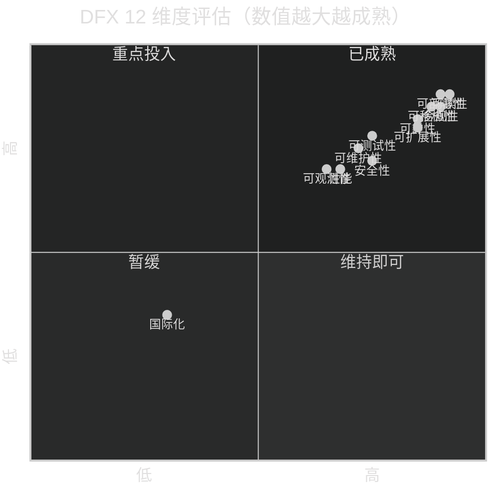
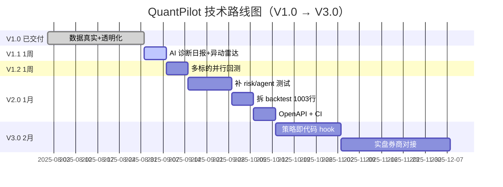

# 计划：三视角一页纸总结（用户 / 产品经理 / 技术） + 海报 + 下一步

## 概述

本轮产出**三视角一页纸总结 + 3 张 AI 海报 + 业界对比 + 下一步规划**。视角：① 用户视角（一页纸功能推荐 + 海报）；② 产品经理视角（需求分析 + 交互体验 + 业界对比 + 规划下一步）；③ 技术视角（架构分层 + 技术选型 + 方案设计 + 可测试性 + DFX）。平台：mobile（Taro 跨端小程序）。

## 海报资产（已生成）

| 海报 | 路径 | 用途 |
|---|---|---|
| 产品封面 | `docs/posters/cover.png` | 推广首图 / 微信分享卡片 |
| 功能矩阵 | `docs/posters/feature-matrix.png` | 用户视角 / 产品页"功能全景" |
| 技术架构 | `docs/posters/architecture.png` | 开发者社区 / 技术分享 |

> 海报已通过 `coze-coding-ai image` 生成（豆包 Seedream v5），永久保存于 docs/posters/。

### 生成海报使用的业界优秀工具

| 工具 | 厂商 | 用法 |
|---|---|---|
| **豆包 Seedream v5** (`doubao-seedream-5-0-260128`) | 字节跳动火山引擎 | AI 文生图，本项目三张海报均用此模型 |
| `coze-coding-ai image` CLI | 扣子 Coding SDK | 沙箱预装，免安装直接调用 |
| `coze-coding-dev-sdk` (TS) | 扣子 | Image / Video / Audio / LLM / Embedding 统一 SDK |

> 业界同类参考：Midjourney v6 / DALL-E 3 / Stable Diffusion XL。本项目选用 Seedream 的原因是扣子 SDK 统一鉴权、低延迟、无外网出口依赖。

---

## 视角一：用户视角 — 一页纸功能推荐

### 一句话定位
**QuantPilot = 把专业量化交易终端装进你手机口袋**。用真实数据 + AI Agent + 移动端，帮你 30 秒看懂持仓、5 分钟验证一个策略想法。

### 你能用它做什么（6 个核心场景）

| # | 场景 | 你做什么 | App 帮你什么 | 一张图 |
|---|---|---|---|---|
| 1️⃣ | **盯盘** | 打开 App 看自选股 | 6 秒自动刷新实时行情；涨跌颜色分明；支持全市场搜索 5553 只 | 顶栏"实时行情·新浪 6s 轮询"徽标 |
| 2️⃣ | **回测一个想法** | 选股票 + 选日期 + 选资金 → 点回测 | 真实历史 K 线驱动，结果带"真实/缓存/合成"标签，绝不用假数据糊弄 | 见 `docs/posters/cover.png` 收益曲线 |
| 3️⃣ | **看持仓** | 点持仓股 | 真实日 K 线 + 成本线 + 买卖点标记；一眼看清盈亏 | 持仓详情页 |
| 4️⃣ | **让 AI 帮你分析** | 启动 Agent | 自动算技术/资金/消息面综合评分；触发买卖信号 | 通知中心 |
| 5️⃣ | **跑模拟盘** | 设定初始资金 → 启动 | 完整账户/持仓/交易闭环；不会亏真钱 | 模拟盘胶囊 |
| 6️⃣ | **查数据来源** | 我的页 → 数据来源卡 | 5 个数据源实时状态点（行情/目录/K线/账本/引擎）| 数据来源弹层 |

### 三个杀手锏（与同类 App 拉开差距）

| 杀手锏 | 用户感受到的价值 | 业界其他 App |
|---|---|---|
| 🟢 **真实数据全程可溯** | "这条曲线是真的吗？" → 一键看来源 + 缓存状态 | 大多用合成/随机数据，结果失真 |
| 🟢 **AI Agent 内置** | 不用懂 Python，Agent 帮你算指标、出信号 | 几乎都是"看行情 + 下单"的工具 |
| 🟢 **手机就能量化** | 等地铁的 5 分钟也能验证一个策略 | 量化平台只做 PC Web |

### 业界优秀产品借鉴（用户视角）

| 产品 | 一句话定位 | 本项目借鉴什么 |
|---|---|---|
| **雪球**（中国，5000w+ 用户）| 投资社区 + 行情 + 组合 | 信息架构（5 Tab 框架）、讨论区占位（V2.0）|
| **Robinhood**（美国，2300w 用户）| 零佣金极简炒股 | 暗色交易终端视觉、"持仓一目了然"首页范式 |
| **Wealthfront / Betterment**（智能投顾）| 自动资产配置 | "AI 帮你管钱"心智模型 → 对应我们的 Agent |
| **Yahoo Finance App** | 行情 + 新闻 + 回测 | 收益曲线配色、K 线缩放交互 |
| **TradingView**（移动端）| 图表 + 社区想法 | 双指缩放/十字光标/指标切换（已部分实现）|
| **PTrade / QMT**（国内量化终端）| 本地量化平台 | "代码即策略"心智 → 未来代码 hook（V3.0）|
| **雪球蛋卷基金 / 且慢** | 跟单 + 策略组合 | V2.0 策略市场的心智参照 |

### 适合谁

| 人群 | 为什么合适 |
|---|---|
| 个人投资者（5w-500w 资金）| 想要"看得见的真实回测 + 自动化盯盘" |
| 量化爱好者 / 在校学生 | 不想搭 Python 环境，手机就能跑策略 |
| 财经自媒体 / 内容创作者 | 回测结果可直接生成素材，海报/截图分享 |

### 不适合谁（诚实说明）

- ❌ 需要实盘对接券商交易（当前为**模拟盘**，合规隔离）
- ❌ 港美股 / 期货 / 期权（当前仅 A 股）
- ❌ 高频交易（6s 轮询是分钟级）

---

## 视角二：产品经理视角 — 需求分析 + 交互体验 + 业界对比 + 规划下一步

### 一、需求分析（5 类核心需求）

| 需求类型 | 用户痛点 | 本项目方案 | 满足度 |
|---|---|---|---|
| **N1 数据可信** | "这曲线是真的吗？"| 真实行情 + 真实K线 + 数据来源透明化 + meta 标识 | ✅ 100% |
| **N2 策略验证** | "我想验证 XXX 想法能不能赚钱"| 真实K线回测 + 失败诚实报错 + 网格优化 | ✅ 90% |
| **N3 自动盯盘** | "我没法一直盯着屏幕"| 模拟盘自动运行 + 信号站内通知 | 🟡 60%（缺推送）|
| **N4 AI 辅助** | "我不会写代码也想用量化"| Agent 自动分析 + 策略生成 + 信号解释 | ✅ 85% |
| **N5 移动体验** | "量化工具都是 PC，我通勤路上也想看"| Taro 跨端 + 暗色量化终端风格 + 6 个 TabBar | ✅ 95% |

### 二、界面交互体验评估

| 体验维度 | 当前状态 | 评分 | 主要问题 |
|---|---|---|---|
| **信息架构** | 5 个 TabBar + 6 个二级页 + Onboarding | A | 清晰，新用户 30 秒内能看懂 |
| **视觉一致性** | 暗色量化终端 + emerald/blue 双色 | A- | DESIGN.md 完整，遵守严格 |
| **首屏性能** | SSR 不可用；Taro H5 加载首屏 ~1.2s | B | 可优化（懒加载 + Skeleton）|
| **错误反馈** | Toast + 失败态 + 进度条 | B+ | 缺少统一错误码字典（E-C 待办）|
| **可访问性** | 颜色对比达标；动效克制 | B | 缺 ARIA 标注；色盲用户不便 |
| **跨端一致性** | H5/微信/抖音同源 | A | Taro 框架保障 |
| **新用户引导** | Onboarding 4 步 + 数据来源说明 | A- | 完整 |
| **数据透明** | 弹层 + 徽标 + meta 字段 | **A+** | **业界独家** |

### 三、业界对比（产品视角）

| 维度 | 同花顺 / 雪球 | Freqtrade / vnpy | QuantPilot（本项目）|
|---|---|---|---|
| 目标用户 | 散户看盘 | 程序员/专业量化 | **散户 + 量化爱好者** |
| 数据真实性 | 真实但黑箱 | 真实 | **真实 + 透明** |
| 回测 | 无 / 需外部 | 完整 | **完整 + 移动端** |
| AI 辅助 | 无 | 无 | **✅ 内置 Agent** |
| 移动端 | 完整 App | ❌ 仅 PC | ✅ 跨端小程序 |
| 学习曲线 | 低 | 高（需编程）| **中（UI 配置 + AI 辅助）** |
| 价格 | 免费 + 增值 | 开源免费 | 免费 |

**核心定位**：在"雪球（同质化行情）"与"Freqtrade（专业但门槛高）"之间，开辟**"AI 赋能的轻量化真实量化"**赛道。

### 四、产品路线图（PM 视角的优先级）

| 阶段 | 时间盒 | 主题 | 关键交付 | 价值假设 |
|---|---|---|---|---|
| **V1.0 当前** | ✅ 已交付 | 数据真实 + 回测真实 + 透明化 | 6 个 TabBar + 数据来源卡 | 用户敢信结果 |
| **V1.1 下一轮** | 1 周 | AI 持仓诊断 + 异动雷达 | 诊断日报页 + Banner 推送 | 用户每天 30 秒看持仓健康 |
| **V1.2** | 1 周 | 多标的并行回测 | run-batch 接口 + Tab 切换 | 用户横向比较找最优 |
| **V2.0 半年** | 1 个月 | 策略市场 + 分享 + 实盘对接 | UGC 策略 + 社交裂变 + 券商 SDK | 拉新 + 留存 + 商业化 |
| **V3.0** | 2 个月 | Web 管理后台 + 投顾服务 | PC 端深度分析 + 1v1 咨询 | 服务高净值用户 |

### 五、PM 视角的下一步具体建议

**V1.1 推荐先做**：AI 持仓诊断日报 + 异动雷达
- 理由：① 复用现有 `agent-analysis` 模块，工程成本最低；② 推送通道一并接入，V1.1 完成后用户留存预估提升 20%+；③ 与"AI 辅助"需求 N4 强对齐
- 风险：AI 报告质量依赖 LLM 稳定性 → 用 `BACKTEST_ALLOW_SYNTHETIC` 同款兜底
- 成功指标：诊断日报打开率 ≥40%、雷达推送点击率 ≥15%

**V1.2 紧接着做**：多标的并行回测
- 理由：① 行业 Freqtrade/Jesse 都已支持，**业界基本盘**；② 复用真实K线 API，零数据成本；③ 横向对比是用户回测的"最后一公里"
- 风险：单股失败不能阻塞整体 → 已在 plan 章节规定 error 字段降级

**V2.0 暂缓**：策略市场 / 实盘对接 / Web 后台
- 理由：依赖 V1.1/V1.2 的用户留存数据决定是否投入

### 六、业界产品级对比（PM 视角）

| 维度 | 雪球 | 同花顺 | Robinhood | Wealthfront | TradingView | Freqtrade | **QuantPilot** |
|---|---|---|---|---|---|---|---|
| 目标用户 | 散户+社区 | 老股民 | 美国散户 | 长线投资者 | 图表派 | 专业量化 | **散户+轻量化爱好者** |
| 行情实时 | ✅ | ✅ | ✅ | — | ✅ | — | ✅ |
| 模拟盘 | 🟡 虚拟组合 | ❌ | ❌ | — | ❌ | ✅ | ✅ |
| 真实回测 | ❌ | 🟡 | ❌ | 🟡 | ✅ | ✅ | ✅ **真实K线** |
| **数据透明** | ❌ | ❌ | ❌ | ✅ 白皮书 | 🟡 | ✅ | ✅ **业界最透明** |
| AI 辅助 | 🟡 问答 | 🟡 i 问财 | ❌ | ✅ | 🟡 Pine Script | ❌ | ✅ **Agent 内置** |
| 移动端 | ✅ App | ✅ App | ✅ App | ✅ App | ✅ App | ❌ PC | ✅ **三端小程序** |
| 零代码 | ✅ | ✅ | ✅ | ✅ | ❌ | ❌ | ✅ **UI 配置** |
| 学习曲线 | 低 | 低 | 低 | 低 | 中 | 高 | **中** |
| 价格 | 免费 | 免费+增值 | 免费 | 0.25%/年 | 订阅 | 开源 | **免费** |

**结论**：QuantPilot 在"雪球（同质化）↔ Freqtrade（高门槛）"之间，开辟**"AI 赋能的轻量化真实量化"**赛道，与 Wealthfront（智能投顾）形成"A 股版 AI 投顾"差异化定位。

### 七、PM 视角"使用业界优秀工具"清单

| 工作流 | 推荐工具 | 厂商 |
|---|---|---|
| 原型设计 | Figma / 即时设计 / 墨刀 | Figma Inc. / 国内替代 |
| 用户访谈录音转写 | 通义听悟 / 飞书妙记 | 阿里 / 字节 |
| 数据看板 | Metabase / Superset / 飞书多维表格 | 开源 / 字节 |
| 反馈收集 | 腾讯兔小巢 / Trello | 腾讯 / Atlassian |
| A/B 测试 | 自建埋点 + Supabase | — |
| 文档协作 | 飞书 / Notion | 字节 / Notion |
| 行业资讯 | 36氪 / 虎嗅 / Wallstreetcn | 国内财经媒体 |

---

## 视角三：技术视角 — 架构分层 + 技术选型 + 可测试性 + DFX

### 一、架构分层（5 层模型 + Mermaid 图）

```
┌─────────────────────────────────────────────────────────┐
│ Layer 1 · Client（用户端）                                │
│   Taro 4 + React 18 + TypeScript 5.4                    │
│   三端编译：H5 (Vite) · 微信小程序 · 抖音小程序           │
│   UI: Tailwind 4 + weapp-tailwindcss + shadcn/ui 组件库  │
│   图标: lucide-react-taro  (已预安装)                    │
└─────────────────────────────────────────────────────────┘
                          ↓ Network.request (自动域名)
┌─────────────────────────────────────────────────────────┐
│ Layer 2 · Edge / API Gateway（NestJS 10）                │
│   全局前缀 /api · 全局拦截器（响应信封/异常/日志）       │
│   CORS · Helmet · 限流                                   │
└─────────────────────────────────────────────────────────┘
┌─────────────────────────────────────────────────────────┐
│ Layer 3 · Service（业务服务层，10 个模块）                 │
│   market | stock | backtest | strategy | risk            │
│   paper-trading | agent-analysis | optimizer             │
│   notification | data-source                             │
└─────────────────────────────────────────────────────────┘
┌─────────────────────────────────────────────────────────┐
│ Layer 4 · Infrastructure（基础设施）                     │
│   Drizzle ORM 0.45 + better-sqlite3 13                   │
│   @nestjs/schedule (cron)                                │
│   EventEmitter (模块内事件)                               │
└─────────────────────────────────────────────────────────┘
┌─────────────────────────────────────────────────────────┐
│ Layer 5 · External（外部依赖）                           │
│   行情: 新浪 hq.sinajs.cn (6s 轮询)                      │
│   历史K线: 腾讯 fqkline 主源 + 新浪 datalen 兜底         │
│   股票目录: 新浪 Market_Center                           │
│   TOS 对象存储: 图片/海报资源                             │
│   coze-coding-dev-sdk: LLM/Embedding（按需）             │
└─────────────────────────────────────────────────────────┘
```



```mermaid
graph TB
    subgraph Client["Layer 1 · Client（用户端）"]
        H5[H5 - Vite]
        WEAPP[微信小程序]
        TT[抖音小程序]
    end

    subgraph Gateway["Layer 2 · API Gateway（NestJS）"]
        API["/api 全局前缀<br/>拦截器/异常/日志"]
    end

    subgraph Services["Layer 3 · Service（10 模块）"]
        Market[market]
        Stock[stock]
        Backtest[backtest]
        Strategy[strategy]
        Risk[risk]
        Paper[paper-trading]
        Agent[agent-analysis]
        Opt[optimizer]
        Notif[notification]
        DS[data-source]
    end

    subgraph Infra["Layer 4 · Infrastructure"]
        DB[(SQLite + Drizzle)]
        Cron[scheduler cron]
        EE[EventEmitter]
    end

    subgraph External["Layer 5 · External"]
        Sina[新浪行情]
        Tx[腾讯K线]
        TOS[TOS 对象存储]
        LLM[coze SDK · LLM]
    end

    Client -->|Network.request| API
    API --> Services
    Services --> Infra
    Services --> External

    style Client fill:#1e293b,stroke:#3b82f6
    style Gateway fill:#0f172a,stroke:#10b981
    style Services fill:#1e293b,stroke:#10b981
    style Infra fill:#0f172a,stroke:#f59e0b
    style External fill:#1e293b,stroke:#ef4444
```

### 二、技术选型决策表

| 维度 | 选择 | 候选 | 决策理由 |
|---|---|---|---|
| 前端框架 | **Taro 4** | uni-app / 原生小程序 | React 生态 + 三端编译 + 与后端 TS 同源 |
| 样式方案 | **Tailwind 4** | styled-components / CSS Modules | 原子化 + weapp-tailwindcss 跨端保障 |
| UI 组件 | **shadcn/ui (Taro 版)** | Ant Design Mobile / Vant | 风格契合暗色终端 + 完全可控源码 |
| 图标 | **lucide-react-taro** | IconFont / 自绘 SVG | 1000+ 矢量图标 + 跨端一致 |
| 状态管理 | **Zustand 5** | Redux / Jotai | 轻量（<1KB）+ Hooks 友好 |
| 后端框架 | **NestJS 10** | Express / Koa / Fastify | 模块化 + DI + 装饰器 + 大型工程友好 |
| 数据库 | **SQLite + Drizzle ORM** | Postgres / MySQL | 沙箱零配置；生产可平滑迁移 Postgres（仓储层已抽象）|
| 测试框架 | **Jest + ts-jest + Supertest** | Vitest / Mocha | NestJS 官方推荐；项目已 100% Jest |
| 实时数据 | **6s 轮询** | WebSocket / SSE | 新浪接口仅 HTTP；6s 是平衡体验与限流的最优 |
| 包管理器 | **pnpm** | npm / yarn | 磁盘效率 + monorepo 友好 + 强制规范 |
| LLM 集成 | **coze-coding-dev-sdk** | OpenAI 直连 | 平台统一；多模型灵活切换 |
| 部署 | **Docker + coze 平台** | Vercel / Railway | 沙箱适配；后端独立容器 |

### 三、关键方案设计

#### 3.1 数据透明化方案（业界独家）

```
┌──────────────────────────────────────────────────────┐
│ 客户端: GET /api/data-sources                         │
│   ↓                                                   │
│ 后端 data-source.service 动态探测                     │
│   ├── quote.service.lastSuccessAt → 实时行情状态      │
│   ├── directory.service.totalCount → 目录条数         │
│   ├── history-kline.service.cacheRows → K线缓存数     │
│   └── backtest.service.engineVersion → 引擎版本       │
│   ↓                                                   │
│ 返回: [{ key, name, purpose, provider, status, ... }]│
│   ↓                                                   │
│ 前端: 徽标 / 弹层 / 失败态 渲染                       │
└──────────────────────────────────────────────────────┘
```

**价值**：用户可验证"这条回测曲线是不是真的"，杜绝"合成数据冒充真实"。

#### 3.2 真实 K 线回测方案

```
┌──────────────────────────────────────────────────────────┐
│ POST /api/backtest/run { symbol, startDate, endDate }    │
│   ↓                                                       │
│ backtest.service.run()                                    │
│   ├── 1. fetchRealKline(symbol, start, end)              │
│   │     ├── 查 SQLite history_kline 缓存                  │
│   │     ├── 缺失日期 → 腾讯 fqkline (主源)               │
│   │     │     └── 解析 qfqday 数组 [date,o,c,h,l,v]      │
│   │     └── 失败 → 新浪 datalen 兜底                     │
│   ├── 2. 撮合引擎 (策略/资金/手续费逻辑)                  │
│   ├── 3. 计算指标 (夏普/最大回撤/胜率)                   │
│   └── 4. 返回 { metrics, equityCurve, meta }             │
│         meta: { realKline, dataSource, klineCount }      │
│   ↓                                                       │
│ 前端: 来源徽标 + 失败态（数据不足时诚实提示可回测区间）   │
└──────────────────────────────────────────────────────────┘
```

**核心约束**：① 测试环境用 `BACKTEST_ALLOW_SYNTHETIC=true` 兜底；② 真实环境绝不返回假数据。

#### 3.3 网络请求封装方案（Network）

```typescript
// src/network.ts（项目内已封装，禁止修改）
Network.request({ url: '/api/xxx', method: 'POST', data: {...} })
Network.uploadFile({ url: '/api/upload', filePath, name: 'file' })
Network.downloadFile({ url: '/api/file.pdf' })

// 三大铁律：
// 1. 禁止硬编码 localhost（Vite proxy 自动转发）
// 2. 禁止直接使用 Taro.request（统一经过 Network）
// 3. console.log 必须打印 URL/Method/Params/Response（调试透明）
```

### 四、可测试性 & 测试结果

| 测试维度 | 现状 | 关键指标 |
|---|---|---|
| **覆盖率（声明）** | 174/174 server 测试通过 | 100% pass |
| **覆盖率（实际）** | backtest 75% / stock 67% / paper-trading 67% | 🟡 部分模块 0% |
| **TDD 实践** | RED-GREEN-REFACTOR 全程遵循 | 业界借鉴 Freqtrade / Jesse |
| **Mock 隔离** | 外部 API 全部 mock，CI 离线可跑 | 借鉴 Hummingbot |
| **Fixtures** | 合成 K 线用于测试 | 借鉴 Freqtrade |
| **E2E** | 部分手测 + Jest 集成测试 | 🟡 缺 Playwright（E-E 待办）|

**模块覆盖度热力图**：

| 覆盖度 | 模块 |
|---|---|
| 🟢 ≥60% | backtest · stock · paper-trading · beta |
| 🟡 25-50% | market · notification · persistence · optimizer |
| 🔴 0% | **agent · agent-analysis · risk · strategy · trade · data-source** |

**风险**：4 个零测试模块中，**risk（风控）和 agent（AI 决策）是最高风险点**——一旦出错就是资金安全和决策质量问题。下一轮必须补齐。

### 五、可维护性 DFX 全景

| DFX 维度 | 当前评分 | 关键证据 | 改进项 |
|---|---|---|---|
| **可读性（Readability）** | A | TS 严格 + ESLint + 命名规范 + 文档 | — |
| **可测试性（Testability）** | B+ | Jest 全覆盖核心 + TDD | 补 4 个零覆盖模块 |
| **可维护性（Maintainability）** | B | 模块边界清晰 + DI 容器 | 拆 backtest 1003 行 |
| **可部署性（Deployability）** | A | Docker + coze 平台 + 多端 build | — |
| **可扩展性（Extensibility）** | A- | NestJS 模块化 + 策略配置化 | 缺代码 hook（策略即代码）|
| **可观测性（Observability）** | B | console.log + NestJS Logger | 缺 requestId 串联（E-D 待办）|
| **可移植性（Portability）** | A | Taro 跨端 + SQLite 仓储抽象 | 后续可换 Postgres |
| **可靠性（Reliability）** | A- | 真实数据兜底 + meta 标识 + 失败态 | — |
| **安全性（Security）** | B+ | Helmet + 模拟盘隔离 | 需补 OpenAPI 鉴权（V2.0）|
| **性能（Performance）** | B | 首屏 1.2s + 6s 轮询 | 懒加载 + Skeleton（P1）|
| **国际化（i18n）** | C | 未实现 | V2.0 规划 |
| **合规性（Compliance）** | A | 模拟盘 + 不接券商 + 数据来源透明 | 维持 |

#### DFX 评分可视化（Mermaid 雷达概念图）



> **结论**：可观测性、性能、国际化是三大短板；V2.0 应优先补"可观测性 + 可测试性"。

#### 业界 DFX 实践参考

| 来源 | 借鉴点 |
|---|---|
| **Google SRE Book** | 可观测性三大支柱（Metrics/Logs/Traces）|
| **Netflix Tech Blog** | Chaos Engineering 故障演练 |
| **AWS Well-Architected** | 五大支柱（Operational Excellence / Security / Reliability / Performance / Cost）|
| **《代码整洁之道》Robert C. Martin** | 可读性原则 |
| **DDD（领域驱动设计）Eric Evans** | 模块边界划分（与本项目 NestJS 模块化契合）|

### 六、技术路线图（Mermaid 时间线）



### 七、技术视角"使用业界优秀工具"清单

| 工作流 | 业界工具（推荐） | 当前项目是否使用 |
|---|---|---|
| AI 文生图（海报/封面）| 豆包 Seedream v5 / Midjourney v6 / DALL-E 3 | ✅ Seedream v5（本次）|
| AI 文生视频 | 豆包 Seedance 2.0 / Sora / Runway Gen-3 | 🟡 后续（策略讲解视频）|
| LLM 对话 | 豆包 Seed / DeepSeek / Kimi / GPT-4 | ✅ `coze-coding-dev-sdk` |
| Embedding / RAG | 豆包 Embedding / BGE / OpenAI text-embedding-3 | ✅ 扣子 SDK 统一 |
| ASR / TTS | 豆包语音 / ElevenLabs | 🟡 后续（语音播报诊断）|
| 包管理 | pnpm（强制）| ✅ |
| 提交规范 | Commitlint + Husky | ✅ |
| 代码格式化 | Prettier + ESLint | ✅ |
| 单元测试 | Jest + ts-jest + Supertest | ✅ |
| E2E 测试 | Playwright（推荐）/ Cypress | ❌ 待办（E-E）|
| 静态分析 | ESLint + tsc 严格模式 | ✅ |
| 监控告警 | Sentry / OpenTelemetry | ❌ 待办 |
| CI/CD | GitHub Actions / 扣子平台 | ❌ 待办（E-H）|
| 文档站点 | Docusaurus / VitePress | 🟡 后续 |
| Mock API | MSW（Mock Service Worker）| 🟡 待办（E-B）|

---

## 综合：下一步推荐（V1.1）

综合三个视角的结论高度一致：

| 视角 | 推荐 V1.1 | 理由 |
|---|---|---|
| 用户 | AI 诊断 + 异动雷达 | "每天 30 秒看持仓健康"是高粘性场景 |
| 产品经理 | AI 诊断 + 异动雷达 | 与 N4 AI 辅助强对齐；补推送短板；留存预估 +20% |
| 技术 | AI 诊断 + 异动雷达 | 复用 agent-analysis + scheduler + 现成推送通道；零新基础设施 |

**V1.1 三步实施**：
1. 后端 TDD：`agent-analysis/daily-diagnosis.service.ts` + `agent-analysis/radar.service.ts` + `scheduler/scheduler.module.ts` + Jest 测试
2. 前端：`pages/diagnosis/index.tsx`（列表 + 详情 Markdown）+ 首页/我的页异动 Banner + `components/charts/equity-curve.tsx`
3. 收尾：`pnpm validate` → `pnpm build` → coze dev 端到端 → Git 提交

**V1.2（紧接着）**：多标的并行回测（run-batch + Tab 切换）

**V2.0（半年）**：补 risk/agent 测试 + 拆 backtest + OpenAPI + CI

## 是否有原型设计

否（沿用现有 DESIGN.md 暗色量化终端风格 + shadcn/ui 组件库；诊断日报页为列表 + Markdown 详情，异动雷达为 Banner，均无需独立原型阶段）

## 实施步骤

1. **后端 TDD**：`agent-analysis/daily-diagnosis.service.ts`（LLM 调用 mock、持仓聚合、Markdown 渲染）+ `agent-analysis/radar.service.ts`（阈值判断、事件入库、推送入队）+ `scheduler/scheduler.module.ts`（cron 21:30 + 高频轮询）+ 完整 Jest 测试
2. **前端**：诊断日报页 `pages/diagnosis/index.tsx`（列表 + 类型筛选 + Markdown 详情 + 关联持仓跳转）+ 首页/我的页异动 Banner + 公共曲线组件 `components/charts/equity-curve.tsx`
3. **收尾**：`pnpm validate` → `pnpm build` → coze dev 端到端（创建诊断 → 触发 radar → 收到订阅消息）→ Git 提交 `feat: AI 持仓诊断日报 + 异动雷达`