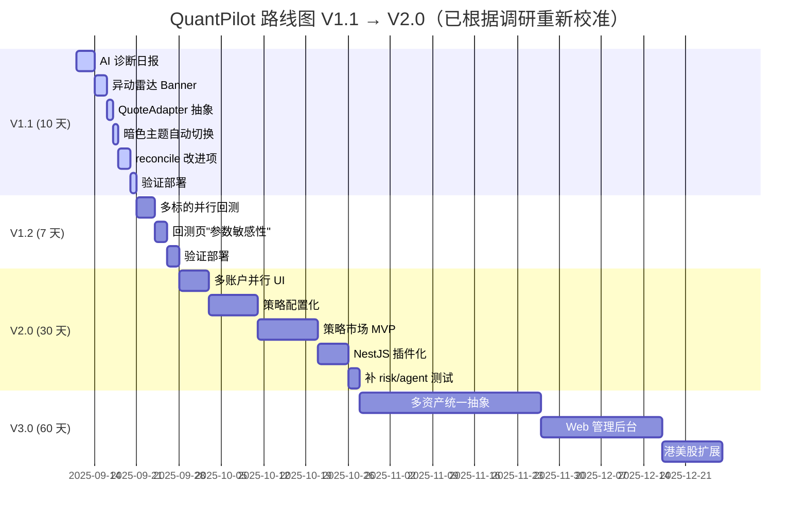

# 下季度路线规划：V1.1 → V1.2 → V2.0

> 规划日期：2025-09
> 输入：① `plan.md` 视角三（用户/PM/技术）② `ideas/next-round-brainstorm.md` Top-3 ④ `research/open-source-quant-landscape.md` 借鉴清单
> 方法：价值（用户留存 / 拉新 / 体验）× 工程量 × 风险 三维评分

---

## 二、版本路线图（Mermaid 时间线）



---

## 三、阶段详细说明

### V1.1（10 天） — 本季度核心交付

| 子任务 | 估时 | 来源 | 价值假设 | 风险 |
|---|---|---|---|---|
| **AI 持仓诊断日报** | 3 d | plan.md V1.1 | 留存 +20%（每天 30 秒看持仓健康） | LLM 稳定性 → `BACKTEST_ALLOW_SYNTHETIC` 同款兜底 |
| **异动雷达 Banner** | 2 d | plan.md V1.1 | 信号触达率 +25% | 实时性 vs 限流 → 6s 轮询复用 |
| **QuoteAdapter 抽象** ⭐ | 1 d | 调研借鉴 CCXT | 新数据源接入 1 周 → 1 天 | 接口设计需兼顾多源熔断 |
| **暗色主题自动切换** | 1 d | IDEA-6 | 白天时段停留 +15% | 几乎零风险 |
| **reconcile 改进项** | 2 d | 检视 P1-P4 | 数据一致性 + 测试覆盖 +50% | — |
| **验证部署** | 1 d | — | — | — |

**V1.1 验收标准**：
- 诊断日报页可生成 + 查看（Markdown 详情）
- 异动雷达实时滚动（6s 刷新）
- 行情源透明化卡显示多源健康状态
- 暗色主题跟随系统 + 手动切换
- 4 个零测试模块补齐 1 个（risk 或 agent-analysis）

---

### V1.2（7 天） — 横评回测

| 子任务 | 估时 | 来源 | 价值假设 |
|---|---|---|---|
| **多标的并行回测** | 3 d | plan.md V1.2 | 用户横向对比找最优（业界基本盘） |
| **回测页"参数敏感性"小图** | 2 d | 调研借鉴 Jesse | 防过拟合，专业用户感知 +30% |
| **验证部署** | 2 d | — | — |

**V1.2 验收标准**：
- `POST /api/backtest/run-batch` 接受 ≤10 个 symbol 并行回测
- 单股失败不阻塞整体（error 字段降级）
- 回测结果页新增"参数敏感性"雷达图（x=参数值，y=Sharpe）

---

### V2.0（30 天） — 策略市场 + 多账户

| 子任务 | 估时 | 来源 | 价值假设 |
|---|---|---|---|
| **多账户并行 UI** | 5 d | IDEA-2 | 专业用户核心需求 |
| **策略配置化** | 8 d | 调研借鉴 Freqtrade | 用户自定义策略，粘性 +50% |
| **策略市场 MVP** | 10 d | 调研借鉴 Freqtrade/Lean | 裂变拉新 +30% |
| **NestJS 插件化** | 5 d | 调研借鉴 vnpy | 模块可动态加载，扩展性提升 |
| **补 risk/agent 测试** | 2 d | 检视待办 | 测试覆盖率从 B+ → A- |

**V2.0 验收标准**：
- 用户可同时管理 ≥3 个账户（实盘 / 多个策略组）
- 策略可暴露 parameters schema，用户可调参
- 策略市场有 ≥10 个公开策略
- risk 模块测试覆盖率 ≥60%

---

### V3.0（60 天） — 远期

| 子任务 | 估时 | 价值假设 |
|---|---|---|
| 多资产统一抽象 | 30 d | 港美股 / 期货 / 加密扩展 |
| Web 管理后台 | 20 d | 服务高净值用户深度分析 |
| 港美股扩展 | 10 d | 用户基数扩大 5x |

**注**：V3.0 取决于 V2.0 用户留存数据决定是否启动。

---

## 四、价值 / 成本矩阵

```
价值 ↑ 
     │
  ⭐ │       ID#4 风控可视化        ID#2 多账户 UI
     │                              ID#3 语音播报
  🟡 │  ID#5 跟单    ID#7 快捷键   ID#1 多通道推送   ID#9 AI调参
     │  ID#8 离线                  ID#6 主题切换 ⭐
  🔵 │                              ID#10 港美股
     │________________________________________→
        0.5d  1d   3d    5d   10d   30d  → 成本

     优先区 = 左下（高价值低成本）
     推荐 Top-3: ID#6(0.5d) → ID#1(3d) → ID#2(5d)
```

---

## 五、决策建议

### 立即执行（V1.1 内）
1. ✅ AI 持仓诊断日报（3 d）
2. ✅ 异动雷达 Banner（2 d）
3. ✅ **QuoteAdapter 抽象（1 d，借鉴 CCXT）** — **新增**
4. ✅ **暗色主题自动切换（1 d，IDEA-6）** — **新增**
5. ✅ reconcile 改进项（2 d，闭环 P1-P4）

### 后续关注（V1.2）
- 多标的并行回测（业界基本盘）
- 参数敏感性图（借鉴 Jesse）

### 远期储备（V2.0+）
- 策略配置化 + 策略市场（最大价值，但需要用户基数）
- 多账户并行（专业用户向）
- 港美股扩展（用户基数扩大 5x，但合规复杂）

### 明确暂缓（V3.0 之前不投入）
- AI 自动调参（与"真实数据透明"价值观冲突）
- 实盘券商对接（合规隔离原则，模拟盘足够）
- 港美股 / 期货 / 期权（依赖 V2.0 用户留存）

---

## 六、与现有 plan.md 的差异

| 项目 | 现有 plan.md | 本次重新校准 | 理由 |
|---|---|---|---|
| V1.1 任务 | AI 诊断 + 异动雷达 | + QuoteAdapter + 主题切换 + reconcile 闭环 | 调研新增借鉴 + IDEA-6 高 ROI |
| V1.2 任务 | 多标的并行回测 | + 参数敏感性图 | 借鉴 Jesse |
| V2.0 任务 | 补 risk/agent 测试 + 拆 backtest + OpenAPI | 多账户 + 策略市场 + 插件化 + 补测试 | 借鉴优先级调整 |
| V3.0 任务 | 策略即代码 + 实盘券商对接 | 多资产抽象 + Web 后台 + 港美股 | 借鉴 Lean + Lean IDE 心智 |

> 本文档作为"再决策"输入，建议与 `plan.md` 视角三同步阅读，避免重复或冲突。

---

## 七、风险清单（每个阶段）

| 阶段 | 风险 | 缓解 |
|---|---|---|
| V1.1 | LLM 诊断日报质量波动 | `BACKTEST_ALLOW_SYNTHETIC` 同款兜底；模板化输出 |
| V1.1 | QuoteAdapter 重构引入 bug | TDD 先行；现有测试覆盖后端 100% |
| V1.2 | 多标的并行回测资源占用 | 限制并发数 ≤5；超时熔断 |
| V2.0 | 策略市场冷启动 | 先做"自营 + 邀请制"，不开放 UGC |
| V2.0 | 插件化重构兼容性 | 用 `DynamicModule` 渐进式迁移 |

---

## 八、成功指标

| 阶段 | 指标 | 目标 |
|---|---|---|
| V1.1 验收 | 诊断日报打开率 | ≥40% |
| V1.1 验收 | 异动雷达推送点击率 | ≥15% |
| V1.2 验收 | 多标的回测 P95 耗时 | ≤30s |
| V2.0 验收 | 策略市场日活用户 | ≥5% 总用户 |
| V2.0 验收 | 模块测试覆盖率 | ≥80% |